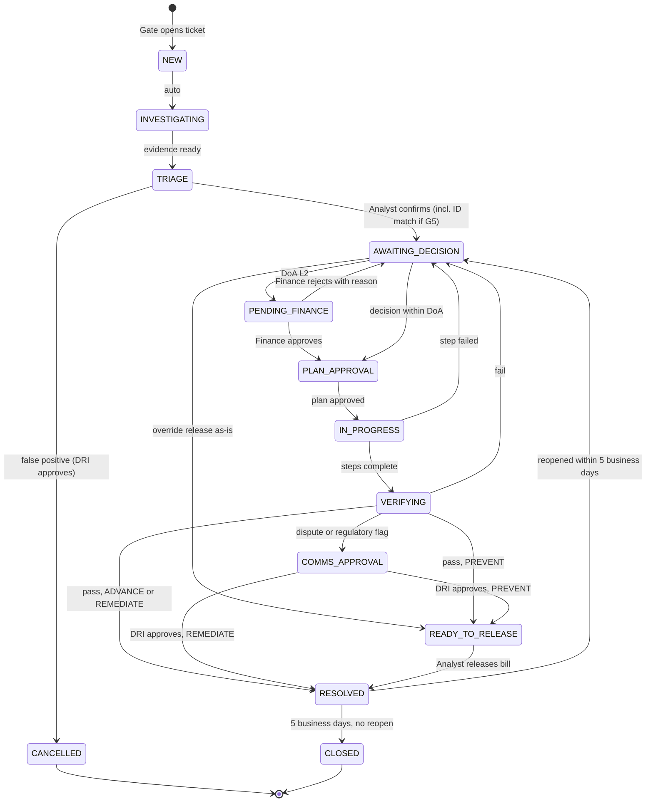
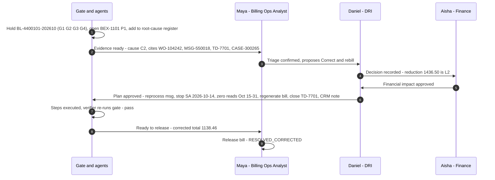

# Utilico Energy – Workflow Rules: Billed After Disconnection

Version 2.0 · Supersedes v1.0 · Applies to the POC 1 pre-bill guard and remediation workflow
Suggested location: `C:\sources\Utilco\poc1\config\workflow_rules.md`

---

## 1. Scope

These rules cover **one problem only**: a customer is billed, or is about to be billed, for days after their service was physically disconnected.

### In scope

| Case | Pattern | Sample |
|---|---|---|
| Disconnect never reached billing | Agreement still active after a stop-service or move-out disconnect; estimated reads billed | E1, E2, E7 |
| ID mismatch | OMS disconnect can't be matched to the billing account, so billing continues | E3 |
| Timing race | Bill runs before the stop is processed | E5 |
| Non-pay window | Estimated consumption billed for days the supply was off | E4 |

### Out of scope

These are handled by other processes and must **not** create tickets here:

- **Usage recorded after a disconnect but not billed** (possible tamper or failed disconnect, sample E6). This is a revenue-protection matter, not over-billing.
- **Fixing the root cause in the integration or CC&B configuration.** The workflow records root causes in a read-only register (§10) for engineering handoff. It does not manage the fixes.
- **Field visits.** The OMS completion record, with technician confirmation, is taken as proof of disconnection.

### Standards basis

The rules are aligned with ITIL 4 Incident Management (ticket lifecycle, priority, SLAs), maker–checker (four-eyes), segregation of duties for financial adjustments, a Delegation of Authority matrix, and RACI.

They also follow the case study's own operating model:

- **Day-to-day:** Billing Ops runs the process.
- **Escalations:** a named DRI owns them.
- **Regulatory:** the DRI reviews every regulatory submission and owns the response.

---

## 2. Personas (trimmed to 3)

| # | Persona | User | user_id | Does |
|---|---|---|---|---|
| 1 | **Billing Operations Analyst** | Maya Chen | `u.billops` | Runs the pre-bill gate. Triages every ticket. Confirms ID matches. Decides low-value cases. **Only person who releases bills.** |
| 2 | **DRI – Billing Exceptions Lead** | Daniel Okoro | `u.dri` | Owns every ticket. Decides everything above the Analyst's limit. Approves execution plans. Owns customer and regulator communications. Reviews the Analyst's low-value decisions daily. |
| 3 | **Finance Controller** | Aisha Rahman | `u.finance` | Approves large pre-issue reductions and **every** credit on bills already issued (revenue already posted to the GL). |

### Why three, and not two

Folding Finance into the DRI would let one person both decide a correction and approve reversing revenue that has already been posted. That breaks segregation of duties for financial adjustments, so Finance stays a separate approver.

Everything else from the earlier design is either out of scope or absorbed:

| Earlier persona | What happened to their work |
|---|---|
| Systems Support | ID-match confirmation goes to the Analyst (maker) and the DRI (checker). Integration fixes are out of scope. |
| Field Operations | Out of scope. |
| Compliance / Regulatory | Regulatory communications go to the DRI, as the case study specifies. Low-value sampling becomes the DRI's daily digest review. |

### Non-human actors

These appear in tickets and the audit log but **can never approve anything**:

| Actor | id | May do |
|---|---|---|
| Pre-bill gate | `sys.gate` | Hold bills, create tickets, set the initial priority |
| Investigation agent | `agent.investigator` | Gather evidence; propose cause, options and drafts |
| Execution agent | `agent.executor` | Propose a plan; execute only approved steps |
| Verifier | `sys.verifier` | Re-run the gate on the corrected result |

---

## 3. Gate rules (deterministic)

| Rule | Fires when | Effect |
|---|---|---|
| G1 | A completed disconnect exists, and the draft bill covers days after it. The disconnect day is billable; the window ends the day before any reconnect. | Hold bill |
| G2 | Post-disconnect days carry ESTIMATED reads | Hold bill |
| G3 | The agreement is still ACTIVE at bill-run time despite a stop-service or move-out disconnect | Ticket; hold only if G1 also fires |
| G4 | The disconnect's integration message is ERROR, SKIPPED or UNPROCESSED at bill-run time | Ticket; hold only if G1 also fires; record in root-cause register |
| G5 | An unmatched disconnect's premise ID is one character from this bill's premise | Hold bill |

Outcome per draft bill:

- **PASSED:** nothing fired.
- **HELD:** G1, G2 or G5 fired.
- **NON_BLOCKING:** only G3 and/or G4 fired. The bill is fine, but the account must be fixed before the next cycle.

---

## 4. Ticket types

All tickets are **Billing Exceptions (BEX)**, owned by the DRI from creation to closure.

| Type | Created by | Meaning |
|---|---|---|
| **PREVENT** | Gate | A draft bill is held before it is issued |
| **ADVANCE** | Gate | The current bill is fine, but the next bill would be wrong unless the account is fixed |
| **REMEDIATE** | Gate (linked) or Analyst (from back-scan) | Credit owed on bills already issued |

Creation rules:

- One ticket per account and root-cause disconnect. A new bill from the same cause is attached to the open ticket instead of creating a duplicate.
- If a PREVENT ticket's cause also affected bills that were already issued, the gate creates a **linked REMEDIATE** ticket.

---

## 5. Lifecycle

| State | Who acts | Allowed actions |
|---|---|---|
| NEW, INVESTIGATING | Gate, agent | Automatic |
| TRIAGE | Analyst | Confirm the finding; confirm or reject a G5 ID match (with evidence note); adjust priority by one level (reason required); request false-positive cancellation; decide directly if within L0 |
| AWAITING_DECISION | Approver per DoA (§7) | Choose an option; override "release as-is" (reason required) |
| PENDING_FINANCE | Finance | Approve or reject the financial impact; credits must post to an OPEN GL period |
| PLAN_APPROVAL | Whoever made the decision | Approve the agent's step plan, or send it back |
| IN_PROGRESS | Execution agent | Approved steps only |
| VERIFYING | Verifier | Pass or fail |
| COMMS_APPROVAL | DRI | Approve or edit the customer letter and regulator response |
| READY_TO_RELEASE | Analyst | Release the corrected bill, or confirm the draft is cancelled |
| RESOLVED | DRI | Reopen within 5 business days |

Failures and rejections always return the ticket to **AWAITING_DECISION** with `returned = true` and its full history.

---

## 6. Options and playbooks

The investigation agent recommends one option. The approver may choose another; choosing a non-recommended option requires a reason and is treated as an override (§7).

| Cause | Options (★ = recommended) | Steps the execution agent may run |
|---|---|---|
| Disconnect not reflected in billing (E1, E2, E7) | ★ Correct and rebill · Release as-is | Reprocess integration message → stop agreement at disconnect date → set post-disconnect reads to zero (CORRECTED) → regenerate or cancel draft bill → close To Do → CRM note |
| ID mismatch (E3) | ★ Correct and rebill (after the Analyst confirms the match) · Release as-is | Correct premise reference → then the steps above |
| Timing race (E5) | ★ Process stop now, then final-bill · Defer to next run | Reprocess message → stop agreement → zero reads → regenerate final bill |
| Non-pay window (E4) | ★ Zero disconnected days, keep fixed charges · Release as-is | Zero reads for the window → regenerate bill |
| Already billed (REMEDIATE) | ★ Credit and notify | Credit memo in the open GL period → CRM note → customer letter (and regulator response if flagged) |

---

## 7. Delegation of Authority

"Amount" means the ticket's reduction on a held draft bill, or its credit on issued bills.

| Level | Approver (decision and plan) | When |
|---|---|---|
| **L0** | Analyst alone | Amount < $50 **and** the recommended option is chosen **and** there is no dispute or regulatory flag **and** the type is PREVENT or ADVANCE |
| **L1** | DRI | Everything not covered by L0 or L2 |
| **L2** | DRI **+ Finance** | Pre-issue reduction ≥ $1,000, **or** any REMEDIATE credit |

Additional rules:

- **Overrides** ("release as-is", or a non-recommended option) always go to the DRI with a reason. If $1,000 or more is at stake, Finance must also approve.
- **Dispute or regulatory flag:** the DRI approves all outbound communications (COMMS_APPROVAL).
- **Compensating control for L0:** the verifier must pass, and every L0 ticket appears in the DRI's daily digest. The DRI marks each one "reviewed" within 1 business day, and that review is audit-logged.

---

## 8. Segregation of duties (server-enforced)

| Rule | Statement |
|---|---|
| SoD-1 | Agents propose; humans approve. No agent or system actor can approve, change priority, or run a step outside the approved plan. |
| SoD-2 | Outside L0, the Analyst proposes and the DRI approves. Nobody approves their own proposal. |
| SoD-3 | Only the Analyst releases bills. The DRI and Finance cannot. |
| SoD-4 | Finance cannot decide or release. The DRI cannot approve the financial impact. |
| SoD-5 | Every override, rejection, priority change, cancellation and reopen requires a written reason. |
| SoD-6 | Every action is written to the append-only, hash-chained audit log: who (user or actor, with role), what (action, object, before → after, reason), when (real time plus scenario time). Blocked attempts are logged as `PERMISSION_DENIED`. |

---

## 9. Priority, SLAs and escalation

### Impact

The highest matching level applies.

| Level | Condition |
|---|---|
| High | Amount ≥ $1,000, or an open dispute or regulatory complaint on the account |
| Medium | Amount $250.00–$999.99 |
| Low | Amount < $250 |
| Modifier | 3 or more bills affected by the same cause (held plus already issued) raises impact by one level |

### Urgency

| Level | Condition |
|---|---|
| High | PREVENT (a bill is on hold), or any dispute or regulatory flag |
| Medium | ADVANCE, or REMEDIATE without a flag |

### Priority matrix

| Impact \ Urgency | High | Medium |
|---|---|---|
| High | P1 | P2 |
| Medium | P2 | P3 |
| Low | P3 | P4 |

### SLA targets

Business hours and business days; all values are configurable.

| Priority | First action | Resolve |
|---|---|---|
| P1 | 1 hour | 1 business day |
| P2 | 4 hours | 2 business days |
| P3 | 1 business day | 5 business days |
| P4 | 2 business days | 10 business days |

Deadline overrides:

- **Held bill:** must be resolved or released within 3 business days of the scheduled run. One business day before that deadline, the ticket automatically becomes P1.
- **ADVANCE:** must be resolved at least 2 business days before the next bill run.
- **Finance approval:** within 1 business day.
- **Regulatory response:** due by the deadline set on the case, if earlier than the SLA.

### Escalation

| Trigger | Action |
|---|---|
| 75% of SLA elapsed | Warning to the assignee |
| 100% of SLA elapsed | Escalate to the DRI. If the DRI is already the assignee, notify the Billing Manager (notification only, outside the app). |

All escalations are audit-logged.

---

## 10. Root-cause register (read-only, no workflow)

Every G4 ticket adds an entry under its integration error signature, with:

- the linked tickets;
- the count of affected accounts;
- the first and last seen dates.

The DRI can export the register as the engineering handoff, matching the case study's Jira output. Fixing these causes is outside this workflow.

---

## 11. Closure codes

| Code | Meaning |
|---|---|
| `RESOLVED_CORRECTED` | Draft corrected and released |
| `RESOLVED_DRAFT_CANCELLED` | Draft cancelled; no bill was due |
| `RESOLVED_ACCOUNT_FIXED` | ADVANCE: account fixed before the next cycle |
| `RESOLVED_CREDIT_POSTED` | REMEDIATE: credit posted and customer notified |
| `RESOLVED_RELEASED_AS_IS` | Override; reason mandatory |
| `CANCELLED_FALSE_POSITIVE` | Gate was wrong; DRI approved |
| `CANCELLED_DUPLICATE` | Merged into another ticket |

---

## 12. RACI

R = Responsible, A = Accountable, C = Consulted, I = Informed.

| Activity | Analyst | DRI | Finance | Agents / system |
|---|---|---|---|---|
| Run gate, hold bills | R | A | – | R (gate) |
| Investigate | I | A | – | R |
| Triage, confirm ID match | R | A | – | C |
| Decide resolution | R (L0) | A / R | C (L2) | C |
| Approve financial impact | – | C | A / R | – |
| Approve plan | R (L0) | A / R | I | C |
| Execute and verify | I | A | – | R |
| Approve customer and regulator communications | I | A / R | – | C (drafts) |
| Release bill | R | A | I | – |
| Review L0 decisions | I | A / R | – | – |
| Export root-cause register | – | A / R | – | R (register) |

---

## 13. Mapping to the app

| v1.0 persona | v2.0 |
|---|---|
| Billing Analyst – Maya Chen | **Billing Operations Analyst** – Maya Chen (`u.billops`). Adds ID-match confirmation. |
| Billing Exceptions Lead – Daniel Okoro | **DRI** – Daniel Okoro (`u.dri`). Adds communications approval and the L0 digest review. |
| Finance Controller – Aisha Rahman | **Finance Controller** – Aisha Rahman (`u.finance`). Unchanged. |
| Systems Support – Tom Becker | Removed. Match confirmation goes to the Analyst; integration fixes are out of scope (register only). |
| Field Operations – Sam Rivera | Removed (out of scope). |
| Compliance Officer – Linda Park | Removed. Communications go to the DRI. The audit log is visible to all three personas. |

---

## Appendix A – Expected routing for the sample data

Ticket numbers are illustrative. Amounts are from the verified sample data. Dataset A unless stated.

### A.1 Replay RUN_2026-11-02 (October draft bills)

| Ticket | Case | Type | Amount | Priority | DoA | Flow |
|---|---|---|---|---|---|---|
| BEX-1101 | E1 Harbourline Logistics | PREVENT | $1,436.50 ($2,574.96 → $1,138.46) | **P1** | L2 | Gate → agent → Maya triages → Daniel decides → **Aisha approves** → Daniel approves plan → agent executes → verifier → Maya releases |
| BEX-1102 | E2 Dana Whitfield | PREVENT | $182.59 (draft cancelled) | **P2** (3 bills) | L1 | Gate → agent → Maya → Daniel decides and approves plan → agent cancels draft → verifier → Maya confirms |
| BEX-1103 | E2 Dana Whitfield | REMEDIATE (linked) | $306.28 credit (Aug + Sep) | **P3** | L2 | Agent → Maya → Daniel → **Aisha** → Daniel approves plan → agent posts credit memo and letter → verifier → resolved |
| BEX-1104 | E3 Copperleaf Studio | PREVENT | $697.50 (draft cancelled) | **P2** | L1 | Gate → agent suggests PRM-00417 → **Maya confirms the match** → Daniel decides and approves plan → agent corrects premise, stops agreement, cancels draft → verifier → Maya confirms |
| BEX-1105 | E3 Copperleaf Studio | REMEDIATE (linked) | $180.00 credit (Sep) | **P4** | L2 | Maya → Daniel → **Aisha** → Daniel approves plan → agent posts credit → resolved |
| BEX-1106 | E5 Priya Natarajan | PREVENT | $14.30 ($194.43 → $180.13) | **P3** | **L0** | Gate → agent → **Maya decides and approves plan** → agent → verifier → Maya releases → appears in Daniel's digest |
| BEX-1107 | E7 Northgate Dental | ADVANCE | $0 (October bill passes) | **P4**, due 2 business days before the 2 Dec run | **L0** | Gate → agent → Maya decides "stop agreement effective 2026-11-01" → agent → verifier → resolved → Daniel's digest |

Accounts with no ticket: E4 (its window ended in September), E6 (out of scope), N1–N5, and all background accounts.

Totals: **$2,330.89 prevented, $486.28 remediated.**

Root-cause register after this run:

| Signature | Tickets |
|---|---|
| Stop SA rejected – pending bill segment | E1 |
| No CC&B mapping for MOVE_OUT | E2 |
| Premise not found in cross-reference | E3 |
| Unprocessed at bill run (delivery delay) | E5 |
| Timeout calling CC&B | E7 |

### A.2 Replay RUN_2026-10-02 (September draft bills)

| Case | Type | Amount | Priority | DoA |
|---|---|---|---|---|
| E2 | PREVENT | $176.70 cancelled | P3 | L1 |
| E2 | REMEDIATE (linked) | $129.58 credit (Aug) | P4 | L2 |
| E3 | PREVENT, after Maya confirms the match | $180.00 ($1,373.26 → $1,193.26) | P3 | L1 |
| E4 Luis Ferreira | PREVENT | $52.92 ($161.60 → $108.68; fixed charges kept) | P3 | L1 (over $50) |

E6: no ticket (out of scope).

### A.3 Replay RUN_2026-09-02 (August draft bills)

| Case | Type | Amount | Priority | DoA |
|---|---|---|---|---|
| E2 | PREVENT | $129.58 ($190.28 → $60.70) | P3 | L1 |

### A.4 BACKSCAN_2026-11-10 (Maya sends POC 1 findings into the workflow)

| Case | Type | Amount | Priority | DoA | Note |
|---|---|---|---|---|---|
| E1 | REMEDIATE | $1,436.50 | **P1** | L2 | Open dispute and regulatory complaint (CASE-300276, CASE-300287), so the ticket passes through COMMS_APPROVAL, where Daniel approves the customer letter and regulator response |
| E2 | REMEDIATE | $488.87 | P2 | L2 | |
| E3 | REMEDIATE, after Maya confirms the match | $877.50 | P3 | L2 | |
| E4 | REMEDIATE | $52.92 | P4 | L2 | |
| E5 | REMEDIATE | $14.30 | P4 | L2 | REMEDIATE is never L0 |

E6's back-scan "REVIEW" finding can't be sent to this workflow, because it's out of scope.

### A.5 Dataset B

E2 and E5 never create tickets. Their root-cause signatures never appear in the register.

### A.6 Sequence – E1 in RUN_2026-11-02

